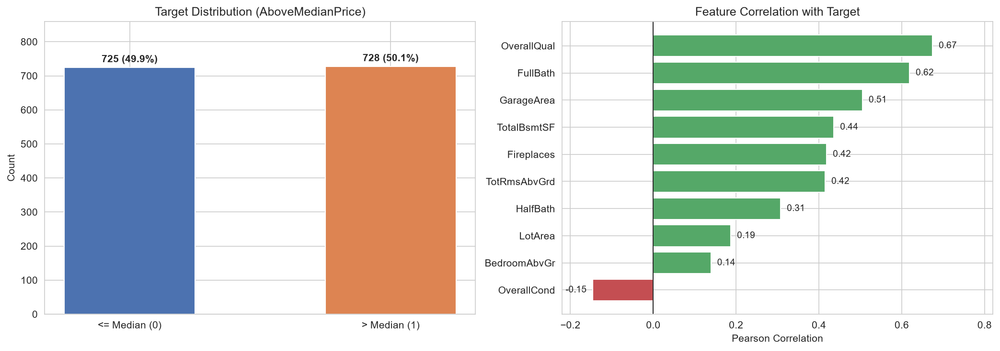
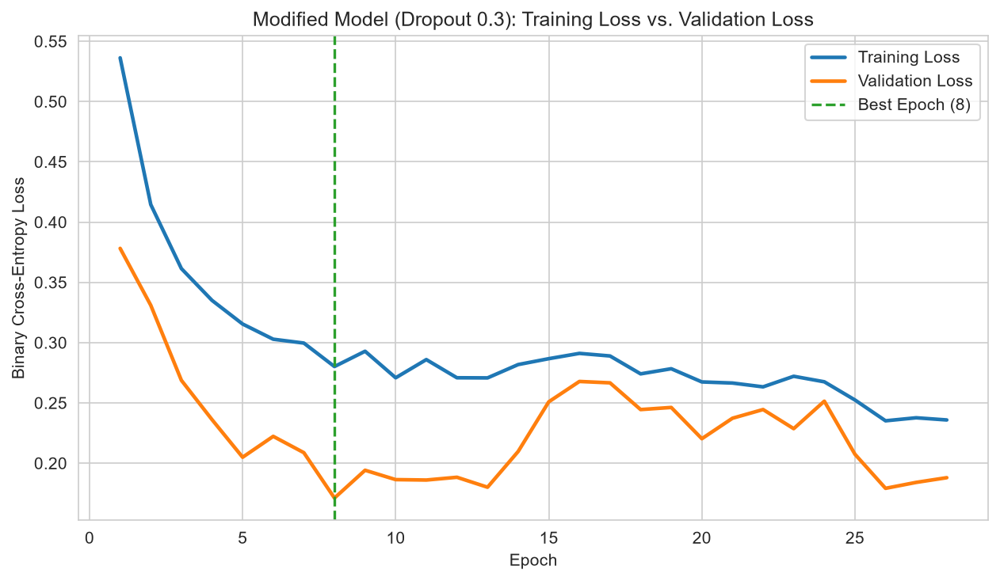
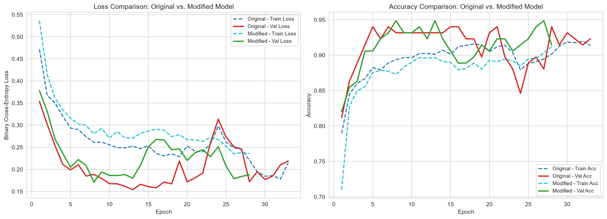
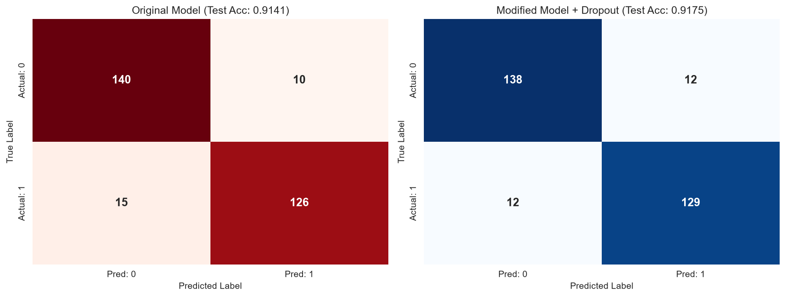

# House Price Classification — Overfitting Reduction (DL)

A Deep Learning binary classification project focused on **reducing overfitting** in an over-parameterized Multi-Layer Perceptron (MLP) predicting whether residential house prices exceed the median (`AboveMedianPrice`).

---

## Overview

The baseline **Original Model** uses four 1,000-unit ReLU hidden layers (**3,015,001** trainable parameters) on a compact tabular dataset, leading to rapid memorization and validation loss spikes.  
This project diagnoses and mitigates that overfitting through:

1. **Duplicate Removal:** Dropping **7 duplicate records** (`1,460` → `1,453` rows) before splitting to eliminate train/test leakage.
2. **Leakage-Free Preprocessing:** Splitting (`1,045` Train / `117` Val / `291` Test) before fitting `MinMaxScaler` exclusively on training features.
3. **Dropout Regularization:** Inserting **`Dropout(0.3)`** after each hidden layer in the **Modified Model** while keeping optimizer (`adam`), batch size (`32`), random seed (`42`), and `EarlyStopping(patience=20, restore_best_weights=True)` identical.

---

## Dataset

- **Source:** `housepricedata.csv` (`1,460` raw rows → `1,453` deduplicated rows, `10` numerical features, `0` missing values)
- **Target:** `AboveMedianPrice` (`0` = Below/At Median: `725` samples / `49.9%`, `1` = Above Median: `728` samples / `50.1%`)

---

## Architecture Comparison

| Component | Original Model | Modified Model |
| :--- | :--- | :--- |
| **Hidden Layers** | 4 × `Dense(1000, relu)` | 4 × (`Dense(1000, relu)` + `Dropout(0.3)`) |
| **Output Layer** | `Dense(1, sigmoid)` | `Dense(1, sigmoid)` |
| **Trainable Parameters** | `3,015,001` | `3,015,001` |
| **Regularization** | None (`EarlyStopping` only) | `Dropout(0.3)` + `EarlyStopping` |

---

## Visual Analysis

### 1. Data Overview & Feature Correlations


### 2. Modified Model (`Dropout 0.3`): Training vs. Validation Loss


### 3. Side-by-Side Comparison: Original vs. Modified Model


### 4. Test Set Confusion Matrices


---

## Results & Overfitting Analysis

| Metric | Original Model | Modified Model (`Dropout 0.3`) | Outcome |
| :--- | :---: | :---: | :--- |
| **Epochs Run (Best Restored)** | 33 (Epoch 13) | 28 (Epoch 8) | Faster convergence |
| **Train Loss** | `0.2230` | `0.2521` | Less memorization |
| **Validation Loss** | `0.1541` | `0.1711` | Stable generalization |
| **Test Loss** | `0.2111` | **`0.2033`** | **Improved (-0.0078)** |
| **Train Accuracy** | `90.62%` | `89.47%` | Reduced overfit |
| **Validation Accuracy** | `93.16%` | **`94.87%`** | **Improved (+1.71%)** |
| **Test Accuracy** | `91.41%` | **`91.75%`** | **Improved (+0.34%)** |
| **Test F1-Score** | `0.9097` | **`0.9149`** | **Improved (+0.0052)** |
| **Test ROC-AUC** | `0.9756` | **`0.9762`** | **Improved (+0.0006)** |

### Key Takeaways
- **Overfitting Reduced:** In the Original Model, validation loss spiked to `0.3136` at Epoch 24 while training loss fell to `0.1781` at Epoch 32. With `Dropout(0.3)`, the Modified Model kept training loss smooth (`0.2359` at Epoch 28) above validation loss (`0.1880`), preventing late-epoch memorization.
- **Better Generalization:** On the `291` unseen test samples, the Modified Model achieved lower test loss (`0.2033` vs. `0.2111`) and higher test accuracy (`91.75%` vs. `91.41%`), F1-score (`0.9149`), and ROC-AUC (`0.9762`).

---

## Project Structure

```text
House-Price-Regularization-DL/
├── House_Price_Regularization.ipynb   # Executed notebook with concise English analysis
├── house_price_regularization.py      # Standalone reproducible Python script
├── housepricedata.csv                 # House Price dataset
├── requirements.txt                   # Dependencies
├── .gitignore
├── README.md
└── figures/                           # Generated high-resolution visualizations
    ├── 01_data_overview.png
    ├── 02_original_model_curves.png
    ├── 03_modified_model_loss.png
    ├── 04_modified_model_curves.png
    ├── 05_loss_and_accuracy_comparison.png
    └── 06_confusion_matrices.png
```

---

## Quick Start

```bash
pip install -r requirements.txt
python house_price_regularization.py
```

Or open and run **`House_Price_Regularization.ipynb`** in Jupyter Notebook / VS Code.
